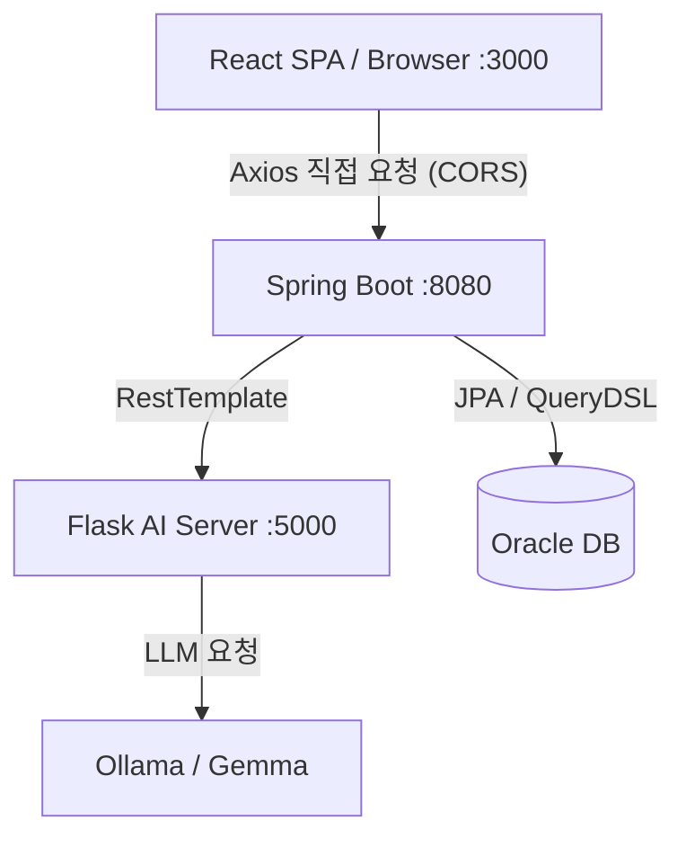

# 🚀 지능형 채용 관리 솔루션 (Intelligent ATS)

> **Spring Boot & Flask 하이브리드 아키텍처 기반의 RAG 챗봇 연동 채용 관리 시스템** > **개발 기간:** 2025.12.01 ~ 2026.01.27 (8주)  
> **Project Leader:** 이재현 (Full Stack & AI Integration)

---

## 📖 프로젝트 개요
기존 채용 플랫폼의 경직된 프로세스와 수작업의 비효율성을 해결하기 위해 개발된 **한국형 ATS(Applicant Tracking System)**입니다.  
기업별 맞춤형 전형 단계 설정부터 AI 기반 공고 작성 보조까지, 채용 담당자의 업무 효율화하는 것을 목표로 합니다.

### 💡 핵심 특화점
1.  **Hybrid Architecture**: 안정적인 Spring Boot(백엔드)와 유연한 Flask(AI 서빙)의 이종 서버 결합
2.  **AI RAG Chatbot**: 직무 및 채용 요건 관련 질문·답변 데이터셋을 TF-IDF로 벡터화하고, 코사인 유사도 기반 검색 결과를 Gemma3 모델의 프롬프트에 반영하여 직무 기술서 초안 생성 기능을 구현
3.  **Dynamic Workflow**: 채용 공고별 전형 단계와 지원 문항을 동적으로 추가·수정·삭제하고, 항목 추가 및 삭제에 따른 표시 순서를 자동 관리하는 맞춤형 입력 폼 구현

---

## 🛠 기술 스택 (Tech Stack)

| Category | Technology |
| --- | --- |
| **Frontend** | React 19, Bootstrap 5, Axios |
| **Backend (Main)** | Java 21, Spring Boot 3.5, Spring Security, JPA/Hibernate, QueryDSL |
| **Backend (AI)** | Python 3.10, Flask, Scikit-learn (TF-IDF), Ollama - gemma3:4b(LLM) |
| **Database** | Oracle Database 23ai free (RDBMS) |
| **Infrastructure** | Spring Security CORS, Gradle, RESTful API |

---

## 🏗 시스템 아키텍처 (System Architecture)



---

## 💾 데이터베이스 설계 (ERD)


---

✨ 주요 기능 (Key Features)
1. 🤖 AI 채용 비서 (RAG Chatbot)

기능: 사용자의 자연어 요청("자바 백엔드 신입 공고 써줘")을 분석하여 직무 기술서 초안 생성.

기술: TF-IDF 벡터 유사도 검색 + LLM(Gemma3:4b)을 활용한 RAG(검색 증강 생성) 구현.

연동: React에서 생성된 초안을 공고 작성 폼에 원클릭 적용 가능.

2. 📝 유연한 공고 관리 (Job Management)

커스텀 전형: 서류전형, 코딩테스트, 면접 등 채용 공고별 전형 단계를 동적으로 추가·수정·삭제할 수 있으며, 항목 추가 시 순서값을 부여하고 삭제 시 남은 단계의 순서값을 자동 재계산.

지원 문항 관리: 채용 공고별 지원 문항의 추가·수정·삭제 기능을 제공하고, 문항 유형(질문형·안내형)과 필수 응답 여부를 설정할 수 있도록 구현.

UI/UX: 직관적인 UI 제공.

상태 관리: 모집 중(OPEN) / 마감(CLOSED) 상태 관리 및 스케줄러를 통한 자동 마감 처리.

3. 🔐 보안 및 인증 (Security)

권한 분리: Spring Security를 활용하여 로그인 상태 및 사용자 역할에 따른 접근 제어를 구현했습니다. 채용 공고의 등록·수정·삭제 API에는 관리자 및 채용 담당자 권한 검사를 적용.

하이브리드 통신: React가 AI 서버에 직접 접근하지 않고, Spring Boot를 Gateway로 통신 경로를 구성.

---

🔥 트러블 슈팅 (Troubleshooting)

### 1. React–Spring 간 CORS 및 Spring–Flask 서버 연동 문제

**초기 문제점**

React 개발 서버(3000)와 Spring Boot 서버(8080)가 서로 다른 출처에서 실행되어 브라우저의 교차 출처 요청 처리가 필요하고, 별도로 실행되는 Flask AI 서버(5000)와의 통신 구조를 구성해야 하는 문제.

**해결 및 적용**

React의 Axios 인스턴스에 Spring Boot 서버 주소(8080)를 설정하여 REST API를 직접 호출.

Spring Security의 CorsConfigurationSource에서 React 개발 서버의 출처(3000)와 인증 정보가 포함된 요청을 허용하도록 설정.

Spring Boot의 ChatController에서 RestTemplate을 이용하여 Flask AI 서버의 챗봇 API로 요청을 중계.

React가 Flask 서버에 직접 접근하지 않고 Spring Boot를 통해 AI 기능을 호출하도록 통신 경로를 구성.


### 2. 동적 입력 폼 데이터의 순서 정합성 유지

**초기 문제점**

사용자가 채용 공고 작성 과정에서 전형 단계(JobStep)와 지원 문항(JobQuestion)을 동적으로 추가하거나 삭제할 때, 항목의 표시 순서(Order)가 불연속적으로 관리될 수 있는 문제.

**해결 및 적용**

프론트엔드 순서 관리: React에서 전형 단계와 지원 문항을 추가할 때 배열 길이를 기준으로 순서값을 부여하고, 항목 삭제 시 배열 인덱스를 기준으로 남은 항목의 order 값을 재계산하여 순서 정합성을 유지.

데이터 저장: 공고 등록 및 수정 요청 시 JobRequestDto를 통해 전형 단계와 지원 문항의 순서 정보를 Spring Boot 서버로 전달하고, JPA 엔티티에 반영하여 데이터베이스에 저장.

백엔드 재정렬 API: JobReorderRequestDto를 통해 변경된 ID 목록을 수신하는 별도의 순서 변경 API(PUT /api/jobs/{jobId}/reorder)를 구현.

JPA 변경 감지 활용: @Transactional 환경에서 각 엔티티의 updateOrder() 메서드로 순서값을 변경하고, JPA의 변경 감지(Dirty Checking)를 통해 트랜잭션 종료 시 변경 사항을 데이터베이스에 반영.


### 3. JPA Fetch Join을 활용한 연관 데이터 조회 최적화

**초기 문제점**

JPA의 지연 로딩(LAZY)으로 인해 연관 엔티티 조회 과정에서 추가 SQL 쿼리가 발생할 수 있는 문제.

**해결 및 적용**

- `JobRepository`에 `LEFT JOIN FETCH`를 적용하여 공고 상세 조회 시 연관된 카테고리 정보를 함께 조회하도록 구현.
- `JobCategoryRepository`에 Fetch Join을 적용하여 상위 카테고리와 하위 카테고리를 함께 조회하도록 개선.
- `CompanyRepository`에 Fetch Join을 적용하여 기업 정보와 소속 사용자 목록을 함께 조회하도록 구현.

**결과**

연관 데이터를 조회할 때 불필요한 추가 쿼리 발생 가능성을 줄이고, 데이터 접근 효율을 개선하도록 조회 로직을 구성.


### 4. QueryDSL 동적 검색 조건 처리

**초기 문제점**

검색 조건이 `null`이거나 공고 상태가 '전체(ALL)'인 경우, 선택적인 검색 조건을 처리하기 위해 쿼리 분기 로직이 복잡해지는 문제.

**해결 및 적용**

QueryDSL의 `BooleanExpression`을 반환하는 별도 메서드(`titleContains`, `categoryEq`, `employmentTypeEq`)로 검색 조건을 분리.

검색 조건이 없는 경우 `null`을 반환하여 `where()`절에서 해당 조건이 자동으로 제외되도록 동적 쿼리 구성.

공고 상태가 `ALL`인 경우에도 상태 조건을 제외하도록 처리.

**결과**

검색 조건별 로직을 분리하여 코드의 가독성과 유지보수성을 높이고, 다양한 필터 조합에 대응할 수 있는 유연하고 타입 안전한 검색 쿼리 구현.


### 5. RAG 도메인 지식 보강을 통한 답변 품질 개선

**초기 문제점**

LLM이 사용자 질문과 관련성이 낮은 일반적인 답변을 생성하거나, 실제 채용 직무와 맞지 않는 용어를 사용하는 환각(Hallucination) 현상 발생.

**해결 및 적용**

`ChatbotData.csv`에 '4년 차 이상 백엔드 개발자 경력직 요구 역량' 등 경력별·직무별 채용 요건에 관한 도메인 지식을 추가하여 데이터셋 보강.

TF-IDF와 코사인 유사도를 활용해 사용자 질문과 관련성이 높은 데이터를 검색하고, 검색 결과를 Ollama Gemma3 모델의 프롬프트에 제공하도록 RAG 파이프라인 구성.

**결과**

경력직 백엔드 개발자의 기술 스택 및 요구 역량에 관한 질문에 대해, 관련 도메인 지식을 검색하여 답변 생성에 활용할 수 있도록 구현.

---

## 📂 프로젝트 구조 (Project Structure)

### 1. AtsProject-Ats (Main Service)
```bash
AtsProject-Ats
├── ☕ backend (Spring Boot)
│   ├── src/main/java/min/boot/ats
│   │   ├── component   # JobScheduler
│   │   ├── config      # Security, QueryDSL, Password 설정
│   │   ├── control     # REST API Controller
│   │   ├── domain      # JPA Entity
│   │   ├── dto         # Request/Response DTO
│   │   ├── repo        # Repository & Custom QueryDSL
│   │   └── service     # 비즈니스 로직
│   └── build.gradle
│
└── ⚛️ front (React)
    ├── src
    │   ├── api         # Axios 인스턴스 설정
    │   ├── components  # Chatbot
    │   ├── context     # AuthContext (로그인 상태 관리)
    │   ├── pages       # 주요 페이지
    │   └── setupProxy.js # Proxy 설정
    └── package.json
```

### 2. AtsProject-Chatbot (AI)
```bash
AtsProject-Chatbot
├── 🐍 ai-server (Flask)
│   └── myApp
│       └── app.py      # Flask 서버 진입점 & RAG 로직
└── data            # 학습용 데이터셋 (ChatbotData.csv, 답변 실패 로그 파일 포함)
```

---


